# LASTRO — Master Architectural Plan & Strategic Roadmap
## Natural Evidence Ingestion, Corporate Ontologies, and Reverse Job Matching

> **Version:** 1.0.0  
> **Status:** Strategic Product Architecture & Execution Roadmap  
> **Date:** October 2026  
> **Authors:** Product Management & Systems Architecture Team

---

## 1. Executive Summary & Thesis

LASTRO was conceived to address the collapse of trust in professional credentials during the AI era. While traditional platforms rely on self-reported profiles, certificates, or unverified claims, LASTRO establishes a cryptographic connection: **observable work evidence → deterministic and AI semantic verification → auditable consensus → Solana on-chain attestation**.

This document charts the roadmap from the current synthetic verification MVP to an enterprise-grade **Proof-Based Talent Liquidity Network**:

```mermaid
flowchart LR
    subgraph Ingestion["1. Natural Ingestion"]
        A1["Google Drive Docs/Sheets"]
        A2["Notion Pages/Spaces"]
        A3["LinkedIn Cases/Posts"]
        A4["GitHub Repos/Commits"]
    end

    subgraph CoreEngine["2. LASTRO Core Engine"]
        B1["Canonical Snapshot"]
        B2["Silent SHA-256 Fingerprint"]
        B3["AI Semantic + Deterministic Consensus"]
        B4["Solana Devnet Attestation"]
    end

    subgraph DualConsumption["3. Dual Purpose Application"]
        C1["Internal Corporate Reskilling"]
        C2["External Hiring Challenges (LinkedIn/ATS)"]
    end

    subgraph LiquidityNetwork["4. Talent Liquidity Network"]
        D1["Verified Capability Passport"]
        D2["Reverse Job Matcher"]
        D3["1-Click Application with Proof"]
    end

    Ingestion --> CoreEngine
    CoreEngine --> DualConsumption
    DualConsumption --> LiquidityNetwork
```



---

## 2. Phase 1: Natural Ingestion & Dual-Purpose Trails

### 2.1 The "Web2 Surface, Web3 Engine" Principle
Mainstream users and enterprise HR teams should never be forced to navigate Web3 complexity (wallets, gas tokens, hex hashes as friction). The blockchain operates strictly under the hood as a silent digital notary.

In the user interface, evidence ingestion transitions from raw code pasting to intuitive connectors:
- **Google Drive:** Spreadsheets, presentations, analysis docs.
- **Notion:** Project specs, research pages, roadmaps.
- **LinkedIn / Web References:** Published cases, formal recommendations, portfolio links.
- **GitHub / Code:** Commits, pull requests, notebooks.

### 2.2 Data Model Extensions (TypeScript)

```typescript
export type EvidenceSourceType = 
  | 'file_upload'        // Local file (code, pdf, notebook)
  | 'google_drive'       // Documents, sheets, presentations
  | 'notion'             // Notion pages or databases
  | 'linkedin_post'      // Published project, case, or recommendation
  | 'github_repo'        // Git repository or commit
  | 'url_reference';     // General canonical URL

export type TrailPurpose = 
  | 'internal_reskilling'   // Corporate workforce AI reskilling
  | 'external_hiring';      // Shareable hiring challenge for recruitment

export interface CustomTrailExtended {
  id: string;
  role: string;
  title: string;
  statement: string;
  purpose: TrailPurpose;
  targetSeniority?: 'junior' | 'mid' | 'senior' | 'lead';
  externalChallenge?: {
    shareableSlug: string;
    publicInstructions: string;
    deadline?: string;
    targetPlatforms: ('linkedin' | 'ats' | 'generic')[];
  };
  criteria: Array<{ id: string; title: string; observables: string[] }>;
  activities: Array<{
    id: string;
    title: string;
    objective: string;
    expectedEvidence: string[];
    acceptedSources: EvidenceSourceType[];
    criteria: string[];
  }>;
}
```

---

## 3. Phase 2: Enterprise Workspaces & Custom Ontologies (BYO Framework)

Corporations in regulated or specialized sectors (fintech, health, energy) possess unique evaluation criteria and compliance requirements.

### 3.1 Architecture of Tenant Isolation
1. **Private Organizational Rubrics:** Weights, confidential data, and proprietary competencies remain private within the organization's tenant.
2. **Deterministic & Semantic Consensus:** Impartial evaluation against the tenant's explicit rules.
3. **Public Cryptographic Handoff:** Only the mathematical record hash and attestation signature are committed on-chain. Integrity is guaranteed without disclosing trade secrets or private data.

---

## 4. Phase 3: The Proof-Based Reverse Job Matching Engine

### 4.1 From Keyword Matching to Proof Depth
Traditional recruitment relies on keyword-stuffed resumes filtered by blind ATS algorithms. LASTRO enables **Reverse Matching by Proof Depth**:

```
Traditional Model (Broken):
[ Candidate writes "Python, AI" in PDF ] ──> [ ATS Keyword Match ] ──> [ 3 technical tests ] ──> [ 45 days ]

LASTRO Model (Capability-First):
[ Verified Hash + Demonstrated Consensus C1-C4 ] ──> [ Engine matches job requirements ] ──> [ Hire in 3 days ]
```

### 4.2 Candidate Capability Passport
A portable, cryptographically verifiable competency profile:

```json
{
  "passport_version": "lastro.passport.v1",
  "subject_id": "usr_ana_2026",
  "verified_capabilities": [
    {
      "competency_id": "comp:data-analysis-reproducible",
      "status": "DEMONSTRATED",
      "attestation_signature": "6mSva1n9oNLkFuFpKfM18BxpqbVF2t8PdkoEWiyzdDT8X3xYfean7n7PVQrNEKVaZBtc91xq59A8FuWAnWyf9Rn",
      "network": "solana-devnet",
      "proven_criteria": ["C1-Analytical-Formulation", "C2-Data-Treatment", "C3-Evidence-Support", "C4-Communication"],
      "verified_at": "2026-10-14T17:33:13.364Z"
    }
  ]
}
```

---

## 5. Execution Roadmap

| Milestone | Deliverables | Status |
|---|---|---|
| **M0: Core Engine & Verification** | Evidence hashing, heuristic AI signal, deterministic consensus, Solana Devnet attestation | ✅ COMPLETED |
| **M1: UX Flow & Multilingual Shell** | Full English UI, UX-aligned sidebar, live on-chain Explorer badge | ✅ COMPLETED |
| **M2: Natural Ingestion & Dual Purpose** | Drive/Notion/LinkedIn source tabs, Reskilling vs. Hiring Challenge toggle, shareable links | 🚀 IN PROGRESS |
| **M3: Tenant Customization & Branding** | Custom rubrics, white-label workspaces, tenant isolation | 📋 PLANNED |
| **M4: Reverse Job Matching Engine** | Capability passport, ATS job requirement crawler, 1-click verified application | 📋 PLANNED |
